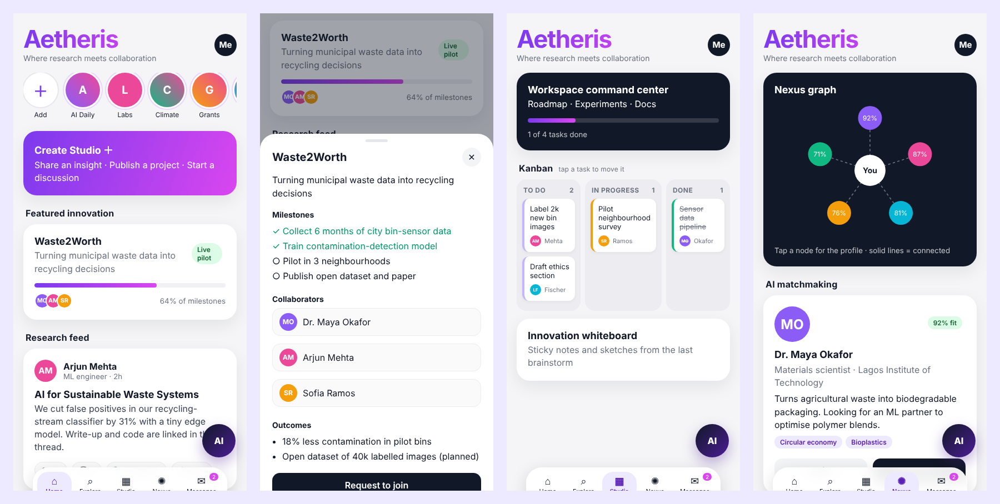

# Aetheris: Clickable Prototype

[](https://github.com/nadeem015/aetheris/actions/workflows/deploy.yml)


**▶ Live demo: https://nadeem015.github.io/aetheris/**

Aetheris is a concept for a **social network for researchers and innovators**. It is a place to share work, find collaborators and funding, and run projects together. This repository holds an interactive, mobile-first prototype built with React and Vite. All the data in it is fictional.



## What you can try

| Tab | Interactions |
|---|---|
| **Home** | Story rings, a "Create Studio" composer (insight, project or discussion), a featured project with milestones and collaborators, and a research feed with like, save, comments and citations |
| **Explore** | Live search across researchers and papers, researcher profiles, paper abstracts, and a grant radar with match levels |
| **Studio** | Workspace command center with roadmap and stats, a **kanban board** (tap a task to move it to the next column, and the progress bar updates), and an innovation whiteboard |
| **Nexus** | An SVG **collaboration graph** where nodes open profiles, and **AI matchmaking** cards. Choosing Connect draws that person's link on the graph. |
| **Messages** | DM threads with unread badges and a working chat box, plus lab rooms with shared docs |
| **AI button** | The "Aether" copilot panel, with scripted collaboration and grant suggestions |

Other details: bottom-sheet dialogs that close with Esc or by tapping outside, toast notifications, keyboard focus styles, and a `prefers-reduced-motion` setting that switches off animations.

## Run locally

```bash
npm install
npm run dev        # http://localhost:5173
npm run build      # production build in dist/
npm run preview    # serve the build
```

Every push to `main` builds the site and deploys it to GitHub Pages through GitHub Actions.

## Structure

```
src/
  App.jsx              app state, tab bar, AI button, and every detail sheet
  data.js              fictional people, projects, papers, grants, tasks and chats
  components/ui.jsx    Avatar, Card, Pill, Sheet, Toast
  screens/             Home, Explore, Studio, Nexus, Messages
  index.css            design tokens and styles
```

## Status

This is a **clickable prototype** for testing the concept and the navigation. It has no backend, accounts or real AI, and nothing persists after a page reload. Possible next steps: user testing of the matchmaking flow, a real search backend, and authentication.

## License

[MIT](LICENSE)
